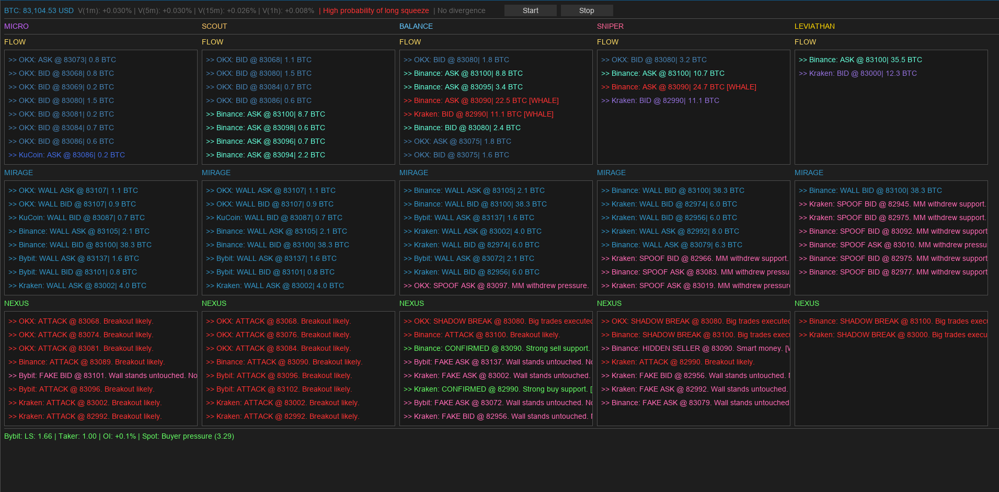
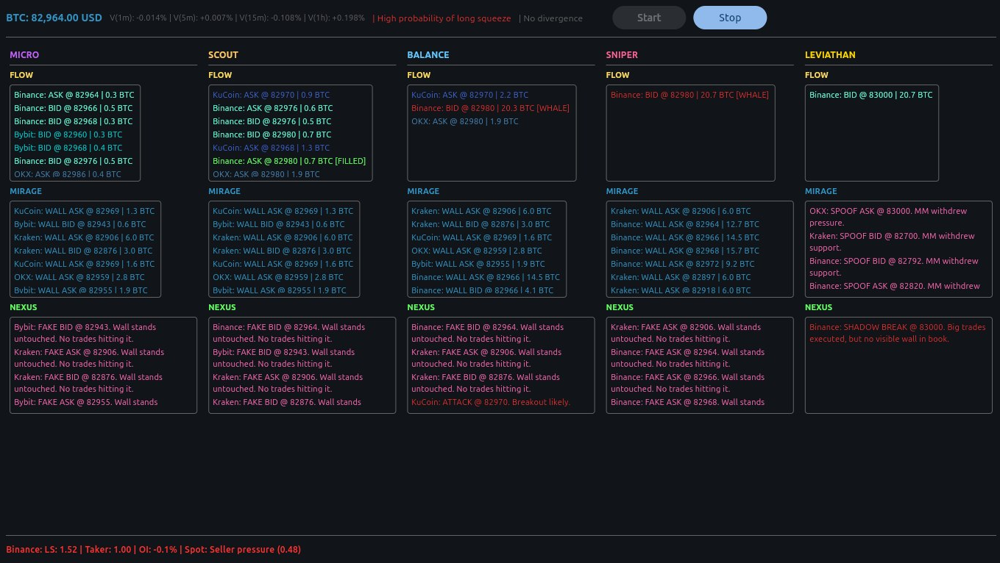

# Council Terminal

# Council Terminal

Real-time cryptocurrency market microstructure analysis tool. Detects hidden liquidity, order book spoofing, and structural imbalances across 5 exchanges simultaneously.

> **Note:** The build presented here is a prototype designed to validate proprietary algorithmic logic (FLOW/MIRAGE/NEXUS architecture). The core engine is implemented in Python. Visualization is handled using Flet and DearPyGui.

## The Problem

Most retail trading tools rely on surface-level price and volume data. Institutional algorithms, however, operate in the gaps: hiding accumulation behind iceberg orders, manipulating sentiment with spoofed walls, and creating structural traps (like long/short squeezes). Standard screeners cannot see this microstructure.

## The Engine (Conceptual Architecture)

Council Terminal solves this by analyzing the divergence between visible order book depth and actual trade executions across Binance, Bybit, KuCoin, OKX, and Kraken simultaneously.

- **FLOW:** Tracks actual executed trade volume. Flags "Icebergs" when execution exceeds visible depth, and "Shadow Breaks" when large volume moves with zero visible support.
- **MIRAGE:** Scans the top levels of the order book for anomalous, static walls. Tracks their lifecycle to distinguish genuine liquidity from manipulation (spoofing).
- **NEXUS:** The confluence engine. Cross-references FLOW and MIRAGE data, applying deduplication tolerance and cascading API fallbacks to generate high-confidence verdicts (`CONFIRMED`, `FAKE`, `HIDDEN BUYER/SELLER`).

## Demo & Resources

### Structural Anomaly Detection

*Coordinated whale activity across SNIPER and BALANCE levels (22.5–35.5 BTC), HIDDEN SELLER verdict, and CONFIRMED signals at the same price zone — rare cross-depth confluence.*

### Multi-Level Confluence

*Double whale bids at 82980 (20.3 + 20.7 BTC), spoof cascades from both sides, and a textbook SHADOW BREAK @ 83000: "Big trades executed, but no visible wall in book."*

### Live Output

A simplified, curated feed of the terminal's real-time detection events is available here: [t.me/council_terminal](https://t.me/council_terminal)

## Tech Stack

- **Language:** Python 3.12+
- **Visualization:** Flet, DearPyGui
- **Data Connectivity:** `ccxt`, `websockets`, `requests`
- **Resilience:** Custom cascading API fallback mechanism and global exception handling for 24/7 autonomous uptime.

---

*Built for institutional-grade visibility. Signal > Noise.*
